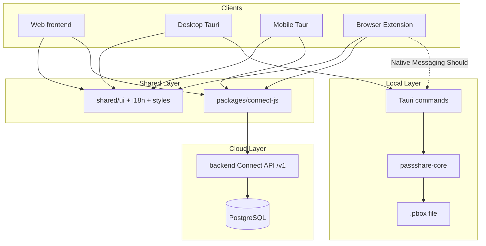

# ADR 003: マルチクライアントアーキテクチャ（Web / Desktop / Mobile / Extension）

## Status

Accepted (2026-05-27) — Issue [#40](https://github.com/AutoDevJapan/PassShare/issues/40)

## Context

PassShare v2.0 では **Web・デスクトップ・モバイル・ブラウザ拡張** の 4 クライアントを本番公開する（[production-v2.md](../spec/production-v2.md)）。

v1（Epic #9）時点の実装状態:

| クライアント | データアクセス | 状態 |
|-------------|--------------|------|
| Desktop | ローカル `.pbox` → `passshare-core`（Tauri invoke） | ✅ 実装済み |
| Web | ランディングのみ | Connect API 未接続 |
| Mobile | — | 未着手 |
| Extension | — | 未着手 |
| Backend | Connect API `/v1`（共有 Bearer `OP_CONNECT_TOKEN`） | ✅ 実装済み |

以下を決定する必要がある。

1. 各クライアントの **正（SSOT）データソース** — ローカル `.pbox` か Connect API か
2. ブラウザ拡張の **接続方式** — Connect API 直結か Desktop Native Messaging か
3. **共有 UI / SDK** の配置と依存方向
4. Desktop の **ローカルファースト** と **クラウド同期** の共存方針

## Decision

### 1. 二層ストレージモデル

PassShare は **ローカル暗号化ストレージ** と **Connect API クラウドストレージ** の二層を維持する（ADR 002 の暗号独自方針を継承）。

| 層 | 実体 | 暗号 | 用途 |
|----|------|------|------|
| **Local** | `.pbox` ファイル | Argon2id + XChaCha20-Poly1305（`passshare-core`） | ゼロナレッジ・オフライン・Desktop 主経路 |
| **Cloud** | PostgreSQL + Connect API | サーバー側は Connect 互換平文フィールド（v2.0 認可後） | Web / Mobile / 拡張の主経路、マルチデバイス |

両層は **同一 Item ドメインモデル**（Connect スキーマ）を共有する。同期・競合解決は [ADR 007](./007-sync-migration-architecture.md)（Epic [#35](https://github.com/AutoDevJapan/PassShare/issues/35) / Issue [#98](https://github.com/AutoDevJapan/PassShare/issues/98)）で定義。

### 2. クライアント別データアクセス

| クライアント | Primary | Secondary（Should） | SDK / 境界 |
|-------------|---------|-------------------|-----------|
| **Desktop** | Local `.pbox`（Tauri → `passshare-core`） | Connect API 同期（[#76](https://github.com/AutoDevJapan/PassShare/issues/76)） | `apps/desktop/src/tauri.ts` |
| **Web** | Connect API | — | `packages/connect-js` |
| **Mobile** | Connect API | — | `packages/connect-js`（Tauri Mobile WebView） |
| **Extension** | Connect API | Native Messaging → Desktop（ローカル `.pbox`） | `packages/connect-js` + optional NM |



### 3. ブラウザ拡張の接続方式

**Primary（Must）: Connect API 直結**

- 拡張機能は `packages/connect-js` 経由で backend Connect API に HTTPS 通信する
- ユーザー認証・ per-user Connect トークンは ADR 004（[#41](https://github.com/AutoDevJapan/PassShare/issues/41)）に従う
- Desktop 未インストール環境でもオートフィル・保存が動作する（Web/Mobile と同一データ）

**Secondary（Should）: Native Messaging → Desktop**

- ローカル `.pbox` のみを利用するユーザー向けオプション（Issue [#96](https://github.com/AutoDevJapan/PassShare/issues/96)）
- Desktop 側 Tauri ネイティブホストが IPC を仲介し、**平文シークレットを拡張のストレージに永続化しない**
- メッセージは JSON + 長さ制限 + オリジン検証。Desktop 未起動時は Connect API にフォールバック
- Safari Web Extension は App Store 経由の Desktop 連携を別途検討（Should）

| 方式 | 採用 | 理由 |
|------|:----:|------|
| Connect API 直結 | **Must** | 4 クライアント共通、Desktop 非依存、認証統一 |
| Native Messaging | **Should** | ローカルファーストユーザー向け。実装コスト高のため v2.0 初期は Connect 優先 |
| 拡張内 `.pbox` 直接読み込み | **Won't** | ブラウザサンドボックスでファイルアクセス不可 |

### 4. モバイル（Tauri Mobile）

- **Tauri v2 Mobile** を第一候補とする（`config.godd` / AGENTS.md スタック一致）
- UI は `shared/ui` + React を Desktop / Web と共有
- データは **Connect API のみ**（ローカル `.pbox` ファイルは v2.0 対象外）
- トークンは OS Secure Storage（Keychain / Keystore）— Issue [#80](https://github.com/AutoDevJapan/PassShare/issues/80)
- 最終選定の PoC は Issue [#78](https://github.com/AutoDevJapan/PassShare/issues/78) で記録。本 ADR と矛盾する場合は ADR を改訂する

### 5. 共有パッケージと依存方向

```
shared/ui, shared/i18n, shared/styles   ←  Presentation（全クライアント）
packages/connect-js                       ←  Cloud API クライアント（Web/Mobile/Extension）
apps/desktop/src/tauri.ts                 ←  Local API クライアント（Desktop のみ）
crates/passshare-core                     ←  Domain + Crypto + Local Storage
backend/                                  ←  Connect API サーバー
```

**依存ルール（MUST）:**

- `shared/*` は backend / Tauri / Node に依存しない
- `packages/connect-js` は `shared/*` に依存してよいが、Tauri / core に依存しない
- Desktop React は `shared/*` + `tauri.ts` の両方を利用可能。Web/Mobile/Extension は Connect のみ
- 新規 UI コンポーネントは **必ず `shared/ui` に置き**、クライアント固有レイアウトのみ各 app に残す

### 6. 認証境界（ADR 004 への委譲）

本 ADR では **データ経路** のみ決定する。ユーザー / セッション / Connect トークンの発行・検証は ADR 004 で定義する。

v2.0 までの移行:

- v1 の共有 `OP_CONNECT_TOKEN` は **v2.0 ブロッカーとして廃止**（Issue [#43](https://github.com/AutoDevJapan/PassShare/issues/43)）
- Web / Mobile / Extension は **ユーザー JWT セッション → Connect トークン** の間接参照とする（[ADR 004](../adr/004-auth-authorization-model.md)）

## Consequences

### Positive

- Web / Mobile / Extension が **同一 Connect API** でデータ共有でき、実装・テストを共通化できる
- Desktop の **ゼロナレッジ・オフライン** 価値を維持しつつ、クラウド同期をオプション追加できる
- `shared/ui` により category UI・i18n・レスポンシブを 4 クライアントで再利用できる
- 拡張は Connect 直結により **Desktop 非依存** で本番提供可能

### Negative

- Desktop と Cloud の **二重実装**（Tauri commands vs Connect API）が一定期間並存する
- Native Messaging は OS / ブラウザごとに設定・審査が異なり、Should でも工数が大きい
- Mobile が Connect のみのため、**完全オフライン Mobile** は v2.0 スコープ外

### Migration / 実装順

1. ADR 004 認可 + Connect 多ユーザー化（[#41](https://github.com/AutoDevJapan/PassShare/issues/41)–[#43](https://github.com/AutoDevJapan/PassShare/issues/43)）
2. Web `/app` + `connect-js`（[#60](https://github.com/AutoDevJapan/PassShare/issues/60)–[#63](https://github.com/AutoDevJapan/PassShare/issues/63)）
3. Extension Connect 直結（[#87](https://github.com/AutoDevJapan/PassShare/issues/87)–[#90](https://github.com/AutoDevJapan/PassShare/issues/90)）
4. Mobile スキャフォールド + Connect（[#78](https://github.com/AutoDevJapan/PassShare/issues/78)–[#81](https://github.com/AutoDevJapan/PassShare/issues/81)）
5. Desktop Connect 同期 Should（[#76](https://github.com/AutoDevJapan/PassShare/issues/76)）
6. Extension Native Messaging Should（[#96](https://github.com/AutoDevJapan/PassShare/issues/96)）

## Alternatives Considered

| 代替案 | 不採用理由 |
|--------|-----------|
| 全クライアント Connect API のみ | Desktop ゼロナレッジ・オフライン価値を失う。ADR 002 / MVP のコア訴求と矛盾 |
| 全クライアント `.pbox` のみ | Web / Extension からローカルファイルを安全に扱えない |
| Extension Native Messaging のみ | Desktop 必須となり、Web/Mobile ユーザーが拡張を使えない |
| Capacitor + 別 UI | `shared/ui` 再利用が弱く、Tauri Mobile で Desktop とスタック統一可能 |
| Extension で Service Worker + 中間プロキシ | 秘密情報が余計なホップを通る。Connect 直結の方が単純で監査しやすい |

## References

- [production-v2.md](../spec/production-v2.md) — v2.0 SSOT
- [ADR 002: 1Password Connect 互換](./002-1password-connect-compatibility.md)
- [1password-connect-compatibility.md](../spec/1password-connect-compatibility.md)
- [design-system.md](../spec/design-system.md)
- Issue [#40](https://github.com/AutoDevJapan/PassShare/issues/40), Epic [#28](https://github.com/AutoDevJapan/PassShare/issues/28)
