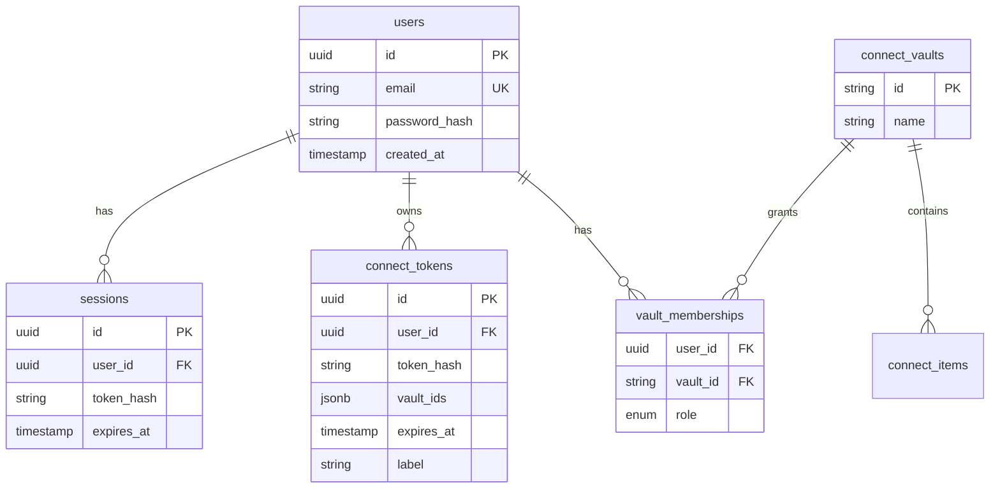
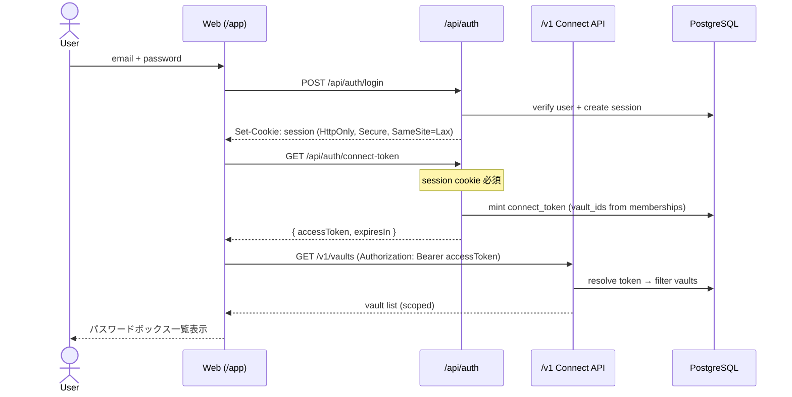
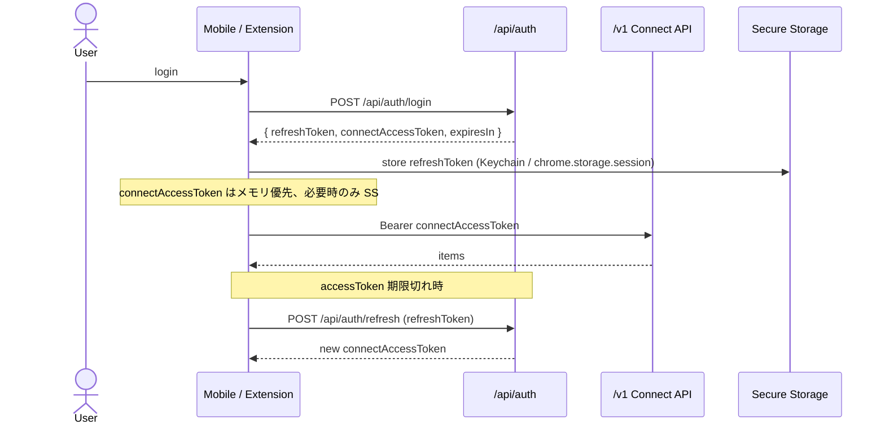
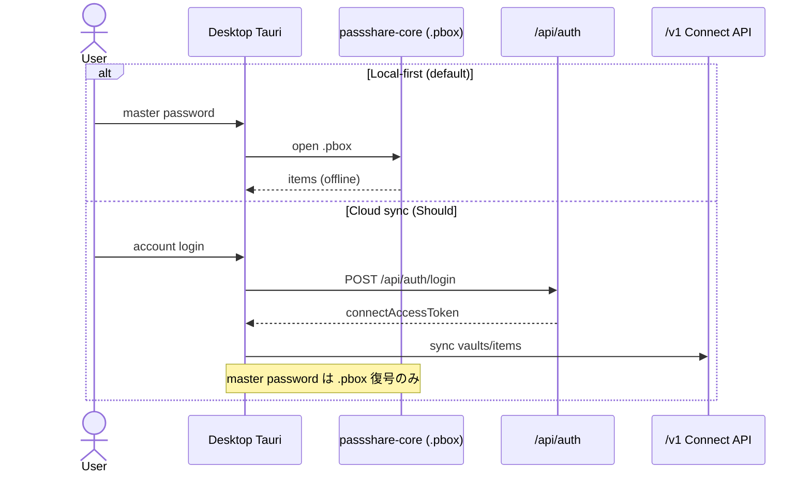

# ADR 004: 認証・認可モデル（ユーザー / セッション / Connect トークン）

## Status

Accepted (2026-05-27) — Issue [#41](https://github.com/AutoDevJapan/PassShare/issues/41)

## Context

v1（Epic #9）の Connect API は **サーバー全体で 1 つの共有 Bearer トークン**（`OP_CONNECT_TOKEN`）で保護されている。

```javascript
// backend/src/middleware/require-connect-auth.js (v1)
if (!token || token !== expected) {
  sendConnectError(res, 401, "PS011: Invalid or missing Connect bearer token");
}
```

この方式では以下が不可能である。

- 複数ユーザーが同一 PassShare インスタンスを安全に共有する
- ユーザー A のトークンでユーザー B のパスワードボックスにアクセスできないことを保証する
- トークン漏洩時の影響を 1 ユーザー / 1 ボックスに限定する
- Web / Mobile / Extension で **アカウント単位** のログイン UX を提供する

[ADR 003](./003-multi-client-architecture.md) ではデータ経路を決定し、認証・認可の詳細は本 ADR に委譲した。

### 用語の分離（MUST）

| 概念 | 用途 | 保存場所 |
|------|------|---------|
| **アカウントパスワード** | PassShare クラウドへのログイン | サーバー（Argon2id ハッシュ） |
| **マスターパスワード** | ローカル `.pbox` の復号 | 端末のみ（サーバーに送らない） |
| **Connect アクセストークン** | `/v1/*` API 呼び出し（Bearer） | クライアント Secure Storage / メモリ |
| **セッション** | Web ログイン状態 | HttpOnly Cookie（Web） |

アカウントパスワードとマスターパスワードは **別物** とし、UI・ドキュメントで混同しない。

## Decision

### 1. 二層認証モデル

| 層 | プロトコル | エンドポイント | 対象クライアント |
|----|-----------|--------------|----------------|
| **L1: アカウント認証** | Email + Password → セッション / リフレッシュトークン | `/api/auth/*`（新規） | Web / Mobile / Extension / Desktop（クラウド利用時） |
| **L2: Connect 認可** | Bearer トークン（1Password Connect 互換） | `/v1/*`（既存） | 全 Connect クライアント + `op` CLI / SDK |

L1 成功後にのみ L2 トークンを発行する。**共有 `OP_CONNECT_TOKEN` は v2.0 で廃止**する（Issue [#43](https://github.com/AutoDevJapan/PassShare/issues/43)）。

### 2. エンティティ関係



| エンティティ | 説明 |
|-------------|------|
| `users` | PassShare アカウント |
| `sessions` | Web 向け HttpOnly セッション（DB または署名付き Cookie + 失効リスト） |
| `connect_tokens` | `/v1` 用 Bearer トークン（平文は発行時のみ表示、DB にはハッシュ保存） |
| `vault_memberships` | ユーザー ↔ パスワードボックス（Vault）の ACL（`owner` / `member`、将来 `viewer`） |

**多ユーザー認可ルール（Must）:**

1. `/v1/vaults` は `vault_memberships` に存在する Vault のみ返す
2. `/v1/vaults/{vaultId}/*` はトークンの `vault_ids` に `vaultId` が含まれる場合のみ許可
3. 他ユーザーの Vault / Item へのアクセスは **403**（Connect 互換エラー形式）
4. `op` CLI / 自動化向け **API トークン** は `connect_tokens` として発行（ユーザー設定画面、Issue [#42](https://github.com/AutoDevJapan/PassShare/issues/42) 実装時）

### 3. シーケンス: Web ログイン → Connect CRUD



### 4. シーケンス: Mobile / Extension



Mobile / Extension では HttpOnly Cookie が使えないため、**リフレッシュトークン + Connect アクセストークン** を JSON で返す。リフレッシュトークンは OS Secure Storage に保存する（Issue [#80](https://github.com/AutoDevJapan/PassShare/issues/80)）。

### 5. シーケンス: Desktop（ローカル vs クラウド）



Desktop の **マスターパスワードはクラウド認証と独立**。クラウド同期時も `.pbox` 暗号化キーは端末上でマスターパスワードから導出する（E2E 方針は同期 Epic [#35](https://github.com/AutoDevJapan/PassShare/issues/35) で詳細化）。

### 6. Connect ミドルウェア（v2.0 方針）

v1 の `token === process.env.OP_CONNECT_TOKEN` を以下に置き換える。

```
Bearer token
  → hash lookup in connect_tokens
  → load user_id + vault_ids + expires_at
  → reject if expired / revoked
  → attach req.connectAuth = { userId, vaultIds }
  → store layer filters by vault_ids
```

**移行期（dev/stg のみ）:** `OP_CONNECT_TOKEN` を **deprecated フォールバック** として残す場合は `APP_ENV=local|dev` に限定し、prd では無効化する。本番は Issue [#43](https://github.com/AutoDevJapan/PassShare/issues/43) 完了をブロッカーとする。

### 7. Web セッション（L1）詳細

Issue [#44](https://github.com/AutoDevJapan/PassShare/issues/44) の実装指針:

| 項目 | 方針 |
|------|------|
| Cookie | `HttpOnly`, `Secure`（prd/stg）, `SameSite=Lax` |
| CSRF | 状態変更（POST/PATCH/DELETE）に CSRF トークン（ダブルサブミット or 同期トークン） |
| 失効 | ログアウトでセッション削除、パスワード変更で全セッション失効 |
| 有効期限 | セッション 7 日（スライディング）、Connect アクセストークン 15 分（要再取得） |

### 8. 脅威モデルと対策

| 脅威 | 影響 | 対策 | Issue |
|------|------|------|-------|
| 共有トークン漏洩（v1） | 全 Vault 漏洩 | per-user Connect トークン（本 ADR） | #43 |
| XSS によるセッション窃取 | アカウント乗っ取り | HttpOnly Cookie, CSP | #46 |
| CSRF | 意図しない操作 | CSRF トークン, SameSite | #44 |
| ブルートフォース | アカウント突破 | レート制限, Argon2id | #45, #42 |
| Connect トークン漏洩 | スコープ内 Vault 漏洩 | 短寿命, vault_ids 限定, 失効 API |
| リフレッシュトークン盗難 | 長期アクセス | Secure Storage, ローテーション | #80 |
| マスターパスワード送信 | ゼロナレッジ破壊 | **サーバーに送らない**（Must） | — |

## Consequences

### Positive

- ユーザー単位のデータ分離が DB / API 境界で強制される
- Connect API / `op` CLI / SDK の **Bearer 互換** を維持しつつ多ユーザー化できる
- Web は Cookie、Mobile/Extension は Secure Storage とクライアント特性に合わせられる
- Desktop ローカルファーストとクラウドの共存が明確

### Negative

- `connect_tokens` / `vault_memberships` テーブルとマイグレーションが必要
- Connect ミドルウェア + Store 全クエリに ACL フィルタが必要（[#43](https://github.com/AutoDevJapan/PassShare/issues/43)）
- 二種類のパスワード（アカウント / マスター）の UX 説明が必要
- `op` CLI ユーザーは API トークン発行フローを踏む必要がある

### Implementation Order

1. DB スキーマ + マイグレーション（users, sessions, connect_tokens, vault_memberships）
2. `/api/auth/*`（[#42](https://github.com/AutoDevJapan/PassShare/issues/42)）
3. Connect ミドルウェア多ユーザー化（[#43](https://github.com/AutoDevJapan/PassShare/issues/43)）
4. Web セッション + CSRF（[#44](https://github.com/AutoDevJapan/PassShare/issues/44)）
5. クライアント統合（Web #61, Mobile #80, Extension #89）

## Alternatives Considered

| 代替案 | 不採用理由 |
|--------|-----------|
| Connect API のみ（アカウント API なし） | Web Cookie UX、トークン発行・失効、監査が困難 |
| JWT のみ（Cookie なし） | XSS で localStorage 窃取リスク。Web は HttpOnly Cookie 優先 |
| OAuth / SSO のみ（v2.0） | 初版工数大。Email+Password を Must、OAuth は v2.1 候補 |
| Vault ごとに独立 OP_CONNECT_TOKEN（env） | スケールしない。ユーザー数 × Vault 数の env 管理は不可 |
| Connect 前に常に `/api/proxy` 経由 | `op` CLI / SDK 互換が崩れる。Bearer 直結を維持 |

## References

- [ADR 003: マルチクライアント](./003-multi-client-architecture.md)
- [production-v2.md](../spec/production-v2.md)
- [1password-connect-compatibility.md](../spec/1password-connect-compatibility.md)
- Issue [#41](https://github.com/AutoDevJapan/PassShare/issues/41), [#42](https://github.com/AutoDevJapan/PassShare/issues/42)–[#44](https://github.com/AutoDevJapan/PassShare/issues/44), [#43](https://github.com/AutoDevJapan/PassShare/issues/43)
- Epic [#28](https://github.com/AutoDevJapan/PassShare/issues/28), [#29](https://github.com/AutoDevJapan/PassShare/issues/29)
