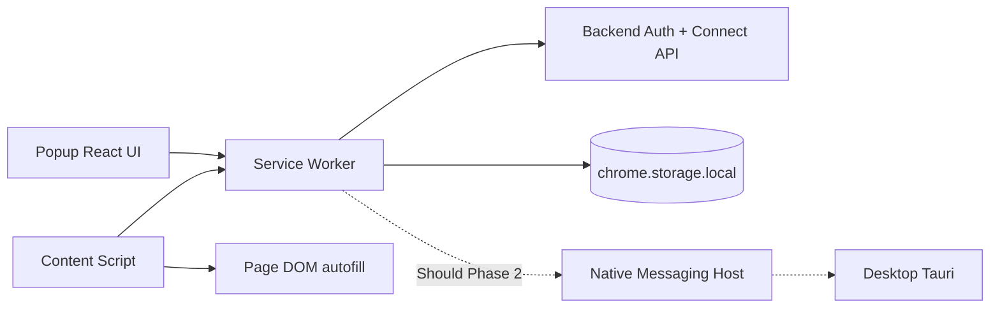

# ADR 006: Browser Extension Architecture (MV3 / Connect API)

## Status

Accepted (2026-05-28) — Issue [#87](https://github.com/AutoDevJapan/PassShare/issues/87)

## Context

Epic [#34](https://github.com/AutoDevJapan/PassShare/issues/34) requires Chrome, Edge, Firefox, and Safari browser extensions with popup UI, autofill, and optional save prompts. [ADR 003](./003-multi-client-architecture.md) already decided:

- **Must:** Connect API direct via `packages/connect-js`
- **Should:** Native Messaging → Desktop for local `.pbox` users ([#96](https://github.com/AutoDevJapan/PassShare/issues/96))

We must choose the extension stack, auth transport, and browser packaging strategy.

## Decision

### 1. MV3 shared core (`packages/extension/`)

| Item | Choice |
|------|--------|
| Manifest | **MV3** for Chrome / Edge / Firefox |
| Build | **Vite + React + `@crxjs/vite-plugin`** |
| UI | `shared/ui`, `shared/i18n`, `shared/styles` (same as Web/Mobile) |
| Popup width | **320px minimum** ([#89](https://github.com/AutoDevJapan/PassShare/issues/89)) |

Safari Web Extension ([#95](https://github.com/AutoDevJapan/PassShare/issues/95)) reuses the same source with platform-specific packaging (Xcode wrapper) documented in the store runbook.

### 2. Auth flow

Extension clients use the token auth flow (same JSON shape as Mobile):

- Header: `X-PassShare-Client: extension`
- Signup/login return `refreshToken` + `connectAccessToken`
- Stateful routes use `Authorization: Bearer <refreshToken>` (CSRF skipped)
- Tokens stored in `chrome.storage.local` (encrypted at rest by OS where available)

Connect tokens are refreshed via `POST /api/auth/token/refresh`.

### 3. Runtime architecture

| Component | Responsibility |
|-----------|----------------|
| **Popup** | Login, search, copy credentials |
| **Service worker** | Token refresh, Connect API proxy, message hub |
| **Content script** | Login form detection, autofill, save prompt UI |

Content scripts never persist secrets; they request fill data from the service worker per action.

### 4. Native Messaging (Should — stub in v2.0)

- Host manifest template under `apps/desktop/native-host/`
- Extension settings show availability status only until Desktop host ships ([#96](https://github.com/AutoDevJapan/PassShare/issues/96))
- Fallback: Connect API when host unavailable (ADR 003)

### 5. Store distribution

| Browser | Issue | Package |
|---------|-------|---------|
| Chrome | [#92](https://github.com/AutoDevJapan/PassShare/issues/92) | MV3 zip → Chrome Web Store |
| Edge | [#93](https://github.com/AutoDevJapan/PassShare/issues/93) | Same build → Edge Add-ons |
| Firefox | [#94](https://github.com/AutoDevJapan/PassShare/issues/94) | MV3 → AMO (review notes for data collection) |
| Safari | [#95](https://github.com/AutoDevJapan/PassShare/issues/95) | Safari Web Extension wrapper |

Store uploads are manual per [extension-store-release.md](../runbooks/extension-store-release.md) until signing automation is configured.

## Consequences

### Positive

- Single TypeScript codebase for 4 browsers
- Connect API parity with Web/Mobile — no Desktop required
- Reuses auth hardening from Mobile ([#80](https://github.com/AutoDevJapan/PassShare/issues/80))

### Negative

- MV3 service worker lifetime limits require stateless message handling
- Safari packaging requires macOS + Apple Developer account
- Native Messaging remains deferred (Should)

## References

- [ADR 003: Multi-client architecture](./003-multi-client-architecture.md)
- [ADR 004: Auth model](./004-auth-authorization-model.md)
- [extension-ui.md](../spec/extension-ui.md)
- [extension-autofill.md](../spec/extension-autofill.md)
- Issues [#87](https://github.com/AutoDevJapan/PassShare/issues/87)–[#97](https://github.com/AutoDevJapan/PassShare/issues/97)
