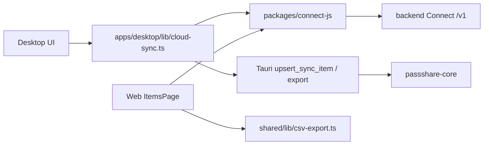

# ADR 007: Sync & Migration Architecture (.pbox ↔ Connect API)

## Status

Accepted (2026-05-28) — Issue [#98](https://github.com/AutoDevJapan/PassShare/issues/98)

## Context

Epic [#35](https://github.com/AutoDevJapan/PassShare/issues/35) requires multi-device sync, conflict resolution, and data migration (1PUX import / CSV export). [ADR 003](./003-multi-client-architecture.md) defines a two-layer storage model but defers sync details to this ADR.

Desktop (#76) already ships optional cloud sync with **conflict detection only**. Epic #35 completes bidirectional MVP sync, manual conflict resolution, and import/export surfaces.

## Decision

### 1. Sync scope (MVP)

| Direction | Behavior |
|-----------|----------|
| **Local → Cloud (push)** | Items present locally but missing remotely are created via Connect API `POST /items`. |
| **Cloud → Local (pull)** | Items present remotely but missing locally are upserted into `.pbox` via Tauri `upsert_sync_item`. |
| **Conflict** | Same `item.id` exists on both sides with differing content fingerprint → user chooses **keep local** (cloud overwrite) or **keep cloud** (local overwrite). |
| **Out of scope (v2.1)** | PassShare Share / team vaults ([#100](https://github.com/AutoDevJapan/PassShare/issues/100)), automatic last-write-wins, CRDT merge. |

### 2. Conflict fingerprint

Items are compared by a stable content fingerprint (not `updatedAt` alone):

- `title`, `category`, `username`, `password`, `url`, `notes`/`body`, `tags` (sorted), `favorite`

Mismatch → conflict. Match → no action.

### 3. Auth & transport

Desktop sync reuses the Web session flow from [#76](https://github.com/AutoDevJapan/PassShare/issues/76):

1. CSRF + login (`/api/auth/login`)
2. Connect token (`/api/auth/connect-token`)
3. Connect API `/v1` via `packages/connect-js`

Master password never leaves the device. Cloud credentials are session-scoped.

### 4. Migration

| Format | Desktop | Web | Implementation |
|--------|---------|-----|----------------|
| **1Password CSV import** | ✅ local `.pbox` | ✅ Connect API | `passshare-core` / `csv-import.ts` |
| **1PUX import** | ✅ Connect API | ✅ Connect API | `POST /v1/vaults/{id}/imports/1pux` ([#54](https://github.com/AutoDevJapan/PassShare/issues/54)) |
| **1Password CSV export** | ✅ local `.pbox` | ✅ Connect items | `passshare-core` / `shared/lib/csv-export.ts` |

1PUX import targets Connect API (cloud vault). Desktop users import into cloud, then pull via sync.

### 5. Module map

## Consequences

- Sync is **opt-in** and **manual** (user triggers "Run sync" / resolves conflicts). No background daemon in MVP.
- 1PUX import requires cloud connectivity; offline-only Desktop users continue with CSV import.
- Conflict resolution is explicit; no silent data loss.
- Future auto-sync can build on the same fingerprint + push/pull primitives.

## References

- [desktop-cloud-sync.md](../spec/desktop-cloud-sync.md)
- [sync-migration.md](../spec/sync-migration.md)
- Epic [#35](https://github.com/AutoDevJapan/PassShare/issues/35)
