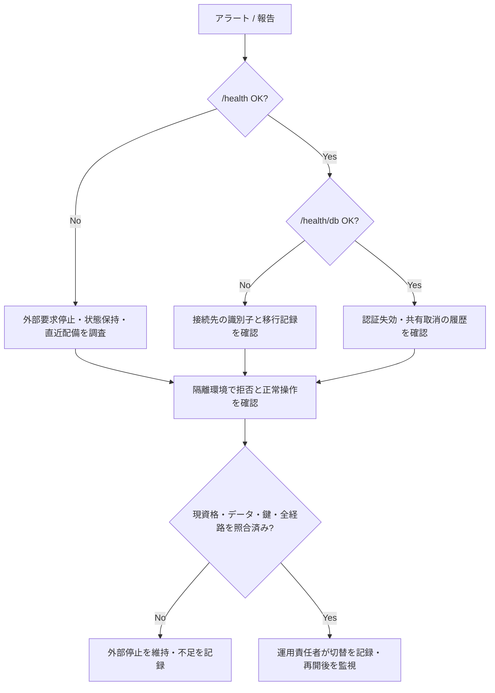

# 運用 Runbook（障害・DB バックアップ）

> Issue [#115](https://github.com/AutoDevJapan/PassShare/issues/115)  
> 親 Epic: [#37](https://github.com/AutoDevJapan/PassShare/issues/37)  
> 最終更新: 2026-10-06

## 目的

本番・ステージング環境の障害対応と PostgreSQL バックアップ検証手順を一本化する。

実施済みの範囲は [復元演習の記録](../audits/operations-readiness.md) を参照する。旧18/54項目に加え、最新mainのRust演習99項目、再開拒否の負例、Railwayの隔離snapshot/PITRと本番保全・接続切替を記録した。本番の復元、全クライアント、本人確認、復号鍵、サービス RTO/RPO の合格記録ではない。[問い合わせ・解約の運用契約](../spec/support-data-lifecycle.md)も販売前の未達条件を含む。

## エスカレーション

| 深刻度 | 例 | 初動 | 通知 |
|--------|-----|------|------|
| S1 | 本番全停止、データ漏えい疑い | 外部要求と業務書込みを止め、障害時の状態を保持。アプリの版戻しと DB の復元を分けて判断 | 運用責任者。顧客への連絡先と通知基準は契約確定後に使用 |
| S2 | `/health/db` 継続 503 | 接続と直近変更を調査。DB を変更せず原因を特定 | 運用担当者 |
| S3 | 単一 PR デプロイ失敗 | 固定 HEAD の CI と配備記録を確認 | 変更担当者 |

受付先は AutoDevJapan の contact@autodevjapan.com、随時受付、初回返信は2営業日を目安とする。[承認済みの契約条件](../spec/commercial-packaging.md)に従い、受信・担当者への配送・同じ受付番号の返信を実経路で検証する。担当体制と実受付の受入は未完である。自動で全員へ送信する運用や24時間対応を、この表から契約上の約束として扱わない。

## 障害対応フロー

### 初動チェックリスト

- [ ] `GET /health` — 200
- [ ] `GET /health/db` — 200, database connected
- [ ] `GET /metrics` — uptime / memory
- [ ] Railway Deployments — 直近 green デプロイ特定
- [ ] Vercel Production — 直前 deployment 確認
- [ ] 外部停止を必要とする障害では、Web、SDK、CLI、デスクトップ、モバイル、拡張からの直通経路も停止済みか確認
- [ ] 接続文字列・認証値・項目本文を問い合わせ、画面画像、ログに出さず、対象の識別子と時刻だけ記録

### Rollback

| コンポーネント | 手順 |
|---------------|------|
| Backend | 停止中の対象 DB スキーマとの互換性を確認し、適合する過去版への配備を記録。稼働 DB の上書き復元を兼ねない |
| Frontend | API と保存形式の互換性を確認して、過去版への切替を判断 |
| Desktop | 現在の保存ファイルを保持し、過去版が形式を読めることを架空データで確認。公開配布は既存の公開承認範囲で行う |

SSOT: [production-release.md](./production-release.md)

## DB バックアップ

### Railway PostgreSQL

| 環境 | インスタンス | バックアップ |
|------|-------------|-------------|
| prd | passshare-postgres-preserved-1177、`4fdfda2d-ed50-4396-9797-25ea7720f720`（2026-10-06、稼働接続を照合） | 永続ボリューム、日次バックアップの保持6日、手動取得と切替前の復元を確認。本番PITRは未有効化 |
| stg | postgres-stg、`7234bbc3-c482-4009-9c88-03063521ffd1`（2026-10-05照合） | ボリュームなし、PITR無効。本番データを演習へ持ち込まない |
| dev/preview | postgres-dev | 開発用 — 本番データを置かない |

### バックアップ検証（四半期推奨）

1. 既存設定を読む段階では、対象サービスとボリュームの ID、方式、有効なスケジュール、最後に成功した取得時刻、復元可能な範囲、保持設定を記録する。秘密設定は取得しない。未確認を「自動バックアップ済み」と表示しない。
2. 新規の復元サービス・ボリューム・保存先を作る前に、既存の承認範囲と費用を確認する。新しい支出が必要なら、対象と費用・作業範囲を示してオーナーへ判断を依頼する。稼働サービスの通常の `Restore` を隔離演習の代わりに実行しない。
3. 元データと接続を変更しない隔離復元先を用意し、取得時刻・復元先 ID・内容の由来を照合する。架空データで schema、全テーブル、追加フィールド、添付のハッシュ、版を検査する。本番 dump をソースリポジトリへ保存しない。
4. 復元 API と外部接続を止めた状態で、[認証と共有の整理手順](../audits/operations-readiness.md#復旧担当が行う手順)を実施する。旧セッション・旧トークン・静的認証、招待、共有、古いパスワード、退会、削除、暗号鍵を現在の記録と照合する。SQL の権限登録を、本人確認や本番の再承認と読み替えない。
5. 接続先を切り替えずに、全対象クライアントで旧資格の拒否、現在の所有者の認可、項目・添付・版の保持を確認する。正常系の smoke と schema 検査だけでは再開を許可しない。
6. RTO は障害の開始から現在の資格で業務再開を確認した時刻まで測る。RPO は最後に復元できた業務更新と障害時点の差、および失われた更新の範囲を記録する。小さい DB の復元・比較時間とは分ける。外部停止、切替、本人確認や鍵の照合を省略した演習ではサービス値を未測定とする。
7. 切替先のサービス ID について、契約に必要なバックアップ方式・保持設定・取得成功を確認する。PITR の復元先は通常の DB として起動し、元サービスのアーカイブ継続を引き継がない。継続に必要な設定と費用の承認がない場合は、その条件を未達として残し再開しない。この手順自体は有効化や支出を承認しない。
8. 運用責任者が確認結果と切替を記録してから再開する。再開後の書込みを保持する。切替失敗時に古い DB を再適用せず、増えた更新を保全して停止へ戻る。
9. 演習専用のコンテナ・ボリューム・イメージ、復元サービスと保存物は、演習結果の保全と用途を照合して回収する。他のサービスや本番バックアップをまとめて削除しない。

2026-10-05 に確認した [Railway のボリュームバックアップ資料](https://docs.railway.com/volumes/backups)では、通常の復元は同一サービスのボリュームを差し替える変更として準備され、配備で反映される。一方、[PITR の資料](https://docs.railway.com/volumes/point-in-time-recovery)では、新しいサービスへ復元する。両者は異なる手順であり、PassShare の実環境で有効な方式を確認してから選ぶ。公式機能の説明は、その環境の設定や復元成功を証明しない。

### 演習記録

| 日付 | 環境 | 方式 | 結果 | 実施者 |
|------|------|------|------|--------|
| 2026-10-04 | 架空 Docker DB | dump / 別 DB restore | DB18項目、HTTP54項目が成功。本番 RTO/RPO 未測定 | ToDo1177/1197、[証拠](../audits/operations-readiness.md) |
| 2026-10-05 | 架空 Docker DB | 同じ候補の再実行 | HTTP54項目が成功。SQL の権限登録と本人確認を区別しイメージ回収を確認 | ToDo1537、[追加記録](../audits/evidence/1537-api-restore-remediation.json) |
| 2026-10-05〜06 | Railway専用架空PG18 | snapshot / 別サービスPITR | 日本語・複数URL・4バイト添付が一致。取得後1件は復元されず、原DBを保持 | ToDo1177、下記監査追記 |
| 2026-10-06 | Railway本番の保全先 | 直接転送 / 保全先snapshot復元 / 接続切替 | 元8テーブルの件数・全文指紋が一致。現在のアカウントと項目が0件であることを停止中に確認 | ToDo1177。全クライアントと業務RTO/RPOは未達 |

### 現在の稼働DBと旧DBの扱い（2026-10-06）

現在の本番接続先は上表の永続DBである。旧 `postgres-prd-v2` は保全・切戻しの参考として保持している。切替後の書込みは旧DBに同期されないので、旧DBへの再接続を単純な切戻しとして行わない。現在のDBと更新を先に保全する。

日次バックアップの保持6日は実設定であり、顧客との取得期限や退会後の保持契約ではない。手動バックアップの取得・復元は確認したが、日次の初回自動取得、6日経過後の消失、本番PITR、暗号鍵の復元、全クライアントの復旧は未検証である。現在の削除・取消記録を反映できない復元先は再開しない。

配備前は設定の参照式だけでなく、Railwayが展開する接続先と対象サービスを内部で比較する。配備後は稼働プロセスの接続先も比較する。URLや認証値は結果へ記録しない。2026-10-06の初回試行は存在しない変数への参照で停止し、元設定へ復帰した。次回は参照式と展開後のURLの混同を検出し、停止前に中止した。展開結果を停止前に照合する手順へ変更してから切替が成功した。

ヘルス成功だけでは認証失効を確認したことにならない。切替後の架空Web・Connect検証で、古い稼働版にログアウト時の接続トークン失効処理がないことを確認した。全42検査が成功した固定mainを配備し、稼働44ファイルと実API15項目を照合した。旧Cookie・接続トークンは401となり、架空データを回収した。この限定経路の成功を全クライアントや退会・鍵の完成に拡大しない。詳細は[監査追記](../audits/operations-readiness.md#2026-10-06の再現可能な演習とrailway実検証)を参照する。

## 監視 SSOT

詳細メトリクス・外部 synthetic 監視: [connect-api-monitoring.md](./connect-api-monitoring.md)

## 関連

- [db-migration.md](./db-migration.md)
- [secret-rotation.md](./secret-rotation.md)
- [staging-acceptance.md](./staging-acceptance.md)
