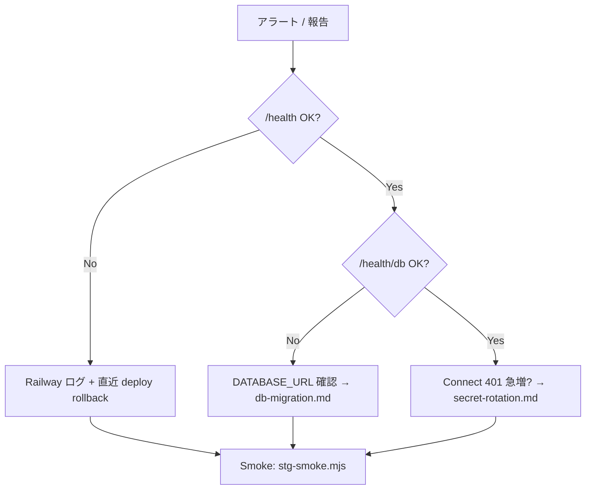

# 運用 Runbook（障害・DB バックアップ）

> Issue [#115](https://github.com/AutoDevJapan/PassShare/issues/115)  
> 親 Epic: [#37](https://github.com/AutoDevJapan/PassShare/issues/37)  
> 最終更新: 2026-05-28

## 目的

本番・ステージング環境の障害対応と PostgreSQL バックアップ検証手順を一本化する。

## エスカレーション

| 深刻度 | 例 | 初動 | 通知 |
|--------|-----|------|------|
| S1 | 本番全停止、データ漏洩疑い | 即時 rollback + secret rotation | 全員 |
| S2 | `/health/db` 継続 503 | DB 接続調査 | オンコール |
| S3 | 単一 PR デプロイ失敗 | CI / Railway ログ確認 | 担当者 |

## 障害対応フロー



### 初動チェックリスト

- [ ] `GET /health` — 200
- [ ] `GET /health/db` — 200, database connected
- [ ] `GET /metrics` — uptime / memory
- [ ] Railway Deployments — 直近 green デプロイ特定
- [ ] Vercel Production — 直前 deployment 確認

### Rollback

| コンポーネント | 手順 |
|---------------|------|
| Backend | Railway → production → 前 green deploy を Redeploy |
| Frontend | Vercel → Promote 前 Production deployment |
| Desktop | GitHub Releases 前バージョンを再公開 |

SSOT: [production-release.md](./production-release.md)

## DB バックアップ

### Railway PostgreSQL

| 環境 | インスタンス | バックアップ |
|------|-------------|-------------|
| prd | postgres-prd-v2 | Railway 自動スナップショット + PITR（プラン依存） |
| stg | postgres-stg | 同上 |
| dev/preview | postgres-dev | 開発用 — 本番データを置かない |

### バックアップ検証（四半期推奨）

1. **stg 環境**でリストア演習（Railway Dashboard → Backups → Restore to new instance または PITR）
2. 復元インスタンスに `DATABASE_URL` を一時設定
3. Smoke:
   ```powershell
   $env:STG_BACKEND_URL = "https://<restored-backend>/..."
   node scripts/stg-smoke.mjs
   ```
4. `pnpm --dir backend migrate:verify` — スキーマ一致
5. 演習記録を下表に追記

### 演習記録

| 日付 | 環境 | 方式 | 結果 | 実施者 |
|------|------|------|------|--------|
| | stg | PITR / snapshot | | |

## 監視 SSOT

詳細メトリクス・外部 synthetic 監視: [connect-api-monitoring.md](./connect-api-monitoring.md)

## 関連

- [db-migration.md](./db-migration.md)
- [secret-rotation.md](./secret-rotation.md)
- [staging-acceptance.md](./staging-acceptance.md)
