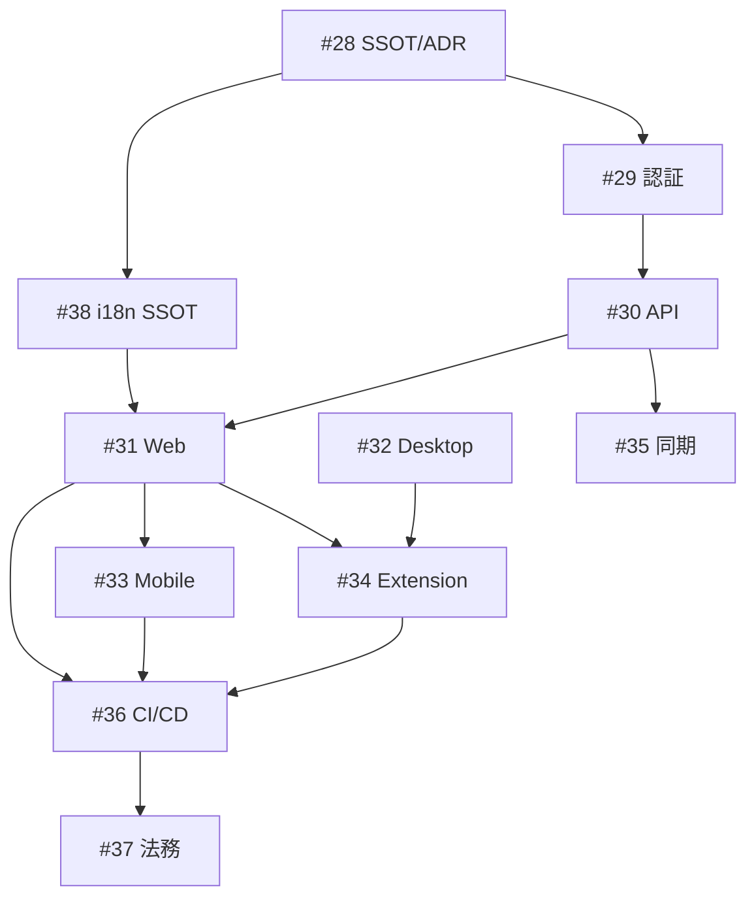

# PassShare v2.0 本番完全版仕様 (SSOT)

> 最終更新: 2026-05-28  
> 関連 Epic: [#28](https://github.com/AutoDevJapan/PassShare/issues/28) ✅ 完了  
> 関連 Issue: [#39](https://github.com/AutoDevJapan/PassShare/issues/39)–[#41](https://github.com/AutoDevJapan/PassShare/issues/41)

## 概要

PassShare v2.0 は **本番公開可能な完全版** を定義する。MVP（v0.1）および 1Password Connect 互換（v1 / Epic #9）を土台に、**Web・デスクトップ・モバイル・ブラウザ拡張** の 4 クライアントを揃え、認証・多言語・レスポンシブ・配布・運用まで含む。

| バージョン | 内容 | 状態 |
|-----------|------|------|
| v0.1 | ローカル `.pbox` + Desktop CRUD | ✅ 完了 |
| v1 | Connect API / `op` CLI / SDK / Desktop category UI | ✅ 完了（Epic #9） |
| **v2.0** | **本番完全版（本 SSOT）** | 🚧 進行中 |

## 前提 SSOT

| ドキュメント | 用途 |
|-------------|------|
| [feature-passshare-mvp.md](./feature-passshare-mvp.md) | 用語・暗号・MVP 受入基準 |
| [1password-connect-compatibility.md](./1password-connect-compatibility.md) | Connect API / データモデル |
| [design-system.md](./design-system.md) | デザイントークン・コンポーネント |
| [ui-polish.md](./ui-polish.md) | i18n 骨格・A11y |
| [infrastructure.md](./infrastructure.md) | Vercel / Railway 環境 |
| [runbooks/secret-rotation.md](../runbooks/secret-rotation.md) | 秘密情報ローテーション |
| [ADR 003: マルチクライアント](../adr/003-multi-client-architecture.md) | 4 クライアント・データ経路・拡張接続 |
| [ADR 004: 認証・認可](../adr/004-auth-authorization-model.md) | ユーザー / セッション / Connect トークン |
| [auth-api.md](./auth-api.md) | L1 認証 API（`/api/auth/*`） |
| [production-i18n.md](./production-i18n.md) | 多言語 SSOT（[#117](https://github.com/AutoDevJapan/PassShare/issues/117) ✅） |

## クライアント一覧

| クライアント | パス | 配布 | Epic |
|-------------|------|------|------|
| Web ポータル | `frontend/` | Vercel | [#31](https://github.com/AutoDevJapan/PassShare/issues/31) |
| デスクトップ | `apps/desktop/` | Win / macOS / Linux インストーラー | [#32](https://github.com/AutoDevJapan/PassShare/issues/32) |
| モバイル | `apps/mobile/`（新規） | App Store / Google Play | [#33](https://github.com/AutoDevJapan/PassShare/issues/33) |
| ブラウザ拡張 | `packages/extension/`（新規） | Chrome / Edge / Firefox / Safari | [#34](https://github.com/AutoDevJapan/PassShare/issues/34) |

共有 UI: `shared/ui/`, `shared/i18n/`, `shared/styles/`

---

## 機能マトリクス（Must / Should / Won't）

凡例: **M** = Must（v2.0 リリースブロッカー） / **S** = Should / **—** = v2.0 対象外

### 認証・セキュリティ（Epic [#29](https://github.com/AutoDevJapan/PassShare/issues/29)）

| 機能 | Web | Desktop | Mobile | Extension | Issue |
|------|:---:|:-------:|:------:|:---------:|-------|
| ユーザー登録 / ログイン / ログアウト | M | M | M | M | [#42](https://github.com/AutoDevJapan/PassShare/issues/42)–[#44](https://github.com/AutoDevJapan/PassShare/issues/44) |
| 多ユーザー Connect 認可（共有トークン廃止） | M | M | M | M | [#43](https://github.com/AutoDevJapan/PassShare/issues/43) |
| レート制限・ブルートフォース対策 | M | — | — | — | [#45](https://github.com/AutoDevJapan/PassShare/issues/45) |
| CSP / CORS / セキュリティヘッダー | M | — | — | — | [#46](https://github.com/AutoDevJapan/PassShare/issues/46) |
| 秘密情報ローテーション Runbook | M | — | — | — | [#47](https://github.com/AutoDevJapan/PassShare/issues/47) |
| クリップボード自動消去 | S | M | M | M | [#48](https://github.com/AutoDevJapan/PassShare/issues/48) |
| 生体認証アンロック | — | S | M | — | [#49](https://github.com/AutoDevJapan/PassShare/issues/49) |

### パスワードボックス操作

| 機能 | Web | Desktop | Mobile | Extension | Issue |
|------|:---:|:-------:|:------:|:---------:|-------|
| パスワードボックス一覧・作成 | M | M* | M | — | [#62](https://github.com/AutoDevJapan/PassShare/issues/62), [#81](https://github.com/AutoDevJapan/PassShare/issues/81) |
| Item CRUD（PASSWORD / SECURE_NOTE） | M | M* | M | S | [#63](https://github.com/AutoDevJapan/PassShare/issues/63), [#81](https://github.com/AutoDevJapan/PassShare/issues/81) |
| 検索 | M | M* | M | M | [#68](https://github.com/AutoDevJapan/PassShare/issues/68) |
| CSV インポート | S | M* | S | — | [#66](https://github.com/AutoDevJapan/PassShare/issues/66) |
| 追加 category（CREDIT_CARD 等） | S | S | S | S | [#53](https://github.com/AutoDevJapan/PassShare/issues/53), [#75](https://github.com/AutoDevJapan/PassShare/issues/75) |

\* Desktop v1 時点でローカル `.pbox` CRUD 済み。v2.0 では Connect API 連携オプション（[#76](https://github.com/AutoDevJapan/PassShare/issues/76)）を Should とする。

### ブラウザ拡張専用

| 機能 | Must | Issue |
|------|:----:|-------|
| ポップアップ UI（ログイン・検索・コピー） | M | [#89](https://github.com/AutoDevJapan/PassShare/issues/89) |
| ログインフォーム検出・オートフィル | M | [#90](https://github.com/AutoDevJapan/PassShare/issues/90) |
| パスワード生成・保存提案 | S | [#91](https://github.com/AutoDevJapan/PassShare/issues/91) |
| Chrome / Edge / Firefox ストア公開 | M | [#92](https://github.com/AutoDevJapan/PassShare/issues/92)–[#94](https://github.com/AutoDevJapan/PassShare/issues/94) |
| Safari Web Extension | S | [#95](https://github.com/AutoDevJapan/PassShare/issues/95) |

### モバイル専用

| 機能 | Must | Issue |
|------|:----:|-------|
| OS オートフィル（Credential Provider / Autofill） | S | [#83](https://github.com/AutoDevJapan/PassShare/issues/83) |
| App Store / Google Play 提出 | M | [#85](https://github.com/AutoDevJapan/PassShare/issues/85) |

### 同期・共有（Epic [#35](https://github.com/AutoDevJapan/PassShare/issues/35)）

| 機能 | v2.0 | Issue |
|------|:----:|-------|
| クラウド同期 MVP（単一ボックス・マルチデバイス） | S | [#99](https://github.com/AutoDevJapan/PassShare/issues/99) |
| PassShare Share（チーム共有） | —（v2.1 候補） | [#100](https://github.com/AutoDevJapan/PassShare/issues/100) |
| 1PUX インポート | S | [#54](https://github.com/AutoDevJapan/PassShare/issues/54), [#101](https://github.com/AutoDevJapan/PassShare/issues/101) |

---

## レスポンシブ（Web Must）

Web ポータルは **320px 以上のすべてのビューポート** で UI が崩れないこと（横スクロールによる意図しないレイアウト破壊なし）。

| ブレークポイント | 幅 | レイアウト | Issue |
|---------------|-----|-----------|-------|
| Mobile | ≤640px | 1 カラム、ボトムナビ、タップ 44px+ | [#64](https://github.com/AutoDevJapan/PassShare/issues/64), [#65](https://github.com/AutoDevJapan/PassShare/issues/65) |
| Tablet | 641–960px | 折りたたみナビ、2 カラム可 | [#64](https://github.com/AutoDevJapan/PassShare/issues/64) |
| Desktop | ≥961px | サイドバー + メイン | [#64](https://github.com/AutoDevJapan/PassShare/issues/64) |

### 受入基準（ATDD）

```gherkin
Given Web アプリを 320px 幅のビューポートで表示した
When  パスワードボックス一覧画面を開く
Then  横スクロールなしで主要操作（作成・検索・開く）が可能

Given Web アプリを 375px 幅（iPhone SE 相当）で表示した
When  Item 作成フォームを開く
Then  すべてのラベルと入力欄が読み取り可能で、ボタンが 44px 以上のタップ領域を持つ
```

拡張機能ポップアップ: 最小幅 **320px** で Must（[#89](https://github.com/AutoDevJapan/PassShare/issues/89)）。

---

## 多言語（i18n / l10n Must）

Epic [#38](https://github.com/AutoDevJapan/PassShare/issues/38) に詳細。v2.0 最低ライン:

| 優先度 | 言語 | ロケール | Issue |
|--------|------|---------|-------|
| Must | 日本語 | `ja` | 既存 |
| Must | 英語 | `en` | 既存 |
| Must | ロシア語 | `ru` | [#118](https://github.com/AutoDevJapan/PassShare/issues/118) |
| Should | 独・仏・西・中・韓・葡 | `de`, `fr`, `es`, `zh-CN`, `zh-TW`, `ko`, `pt-BR` | [#119](https://github.com/AutoDevJapan/PassShare/issues/119) |

表示保全（Must）:

- スクリプト別タイポグラフィ（CJK / Latin / Cyrillic）— [#120](https://github.com/AutoDevJapan/PassShare/issues/120)
- `word-break: break-all` のグローバル適用禁止（jp-ui-contracts）
- 翻訳キー欠落 CI — [#126](https://github.com/AutoDevJapan/PassShare/issues/126)
- locale 別 Visual Regression — [#128](https://github.com/AutoDevJapan/PassShare/issues/128)

---

## 品質ゲート（v2.0 リリース前）

| 項目 | 基準 | Issue |
|------|------|-------|
| Rust 単体テスト | Docker 上で全 pass | [#105](https://github.com/AutoDevJapan/PassShare/issues/105) |
| Backend 統合テスト | npm test 全 pass | [#58](https://github.com/AutoDevJapan/PassShare/issues/58) |
| Web E2E | ログイン → CRUD → ログアウト | [#68](https://github.com/AutoDevJapan/PassShare/issues/68) |
| Lighthouse（Web ランディング + /app） | A11y 90+, Best Practices 90+ | [#69](https://github.com/AutoDevJapan/PassShare/issues/69) |
| Desktop 署名ビルド | Win / macOS / Linux | [#70](https://github.com/AutoDevJapan/PassShare/issues/70)–[#73](https://github.com/AutoDevJapan/PassShare/issues/73) |
| stg 受入 smoke | 全クライアント | [#106](https://github.com/AutoDevJapan/PassShare/issues/106) |
| 利用規約・プライバシー | Web 公開 | [#113](https://github.com/AutoDevJapan/PassShare/issues/113) |

---

## Epic トレーサビリティ

| Epic | # | 子 Issue 範囲 | 完了条件 |
|------|---|--------------|---------|
| v2.0 SSOT / ADR | [#28](https://github.com/AutoDevJapan/PassShare/issues/28) ✅ | #39–#41 | 本 SSOT + [ADR 003](../adr/003-multi-client-architecture.md) + [ADR 004](../adr/004-auth-authorization-model.md) Accepted |
| 認証・セキュリティ | [#29](https://github.com/AutoDevJapan/PassShare/issues/29) ✅ | #42–#50 | 多ユーザー認可 + セッション + クリップボード / 監査 |
| Connect API 本番化 | [#30](https://github.com/AutoDevJapan/PassShare/issues/30) ✅ | #51–#59 | OpenAPI Must ギャップ 0 |
| Web 完全版 | [#31](https://github.com/AutoDevJapan/PassShare/issues/31) ✅ | #60–#69 | 320px レスポンシブ + E2E |
| Desktop 本番化 | [#32](https://github.com/AutoDevJapan/PassShare/issues/32) ✅ | #70–#77 | 署名 + 自動更新 |
| スマホアプリ | [#33](https://github.com/AutoDevJapan/PassShare/issues/33) ✅ | #78–#86 | ストア提出 |
| ブラウザ拡張 | [#34](https://github.com/AutoDevJapan/PassShare/issues/34) | #87–#97 | 4 ブラウザ + オートフィル |
| 同期・共有 | [#35](https://github.com/AutoDevJapan/PassShare/issues/35) | #98–#103 | 同期 MVP（Should） |
| CI/CD | [#36](https://github.com/AutoDevJapan/PassShare/issues/36) | #104–#110 | main CI green |
| 法務・運用 | [#37](https://github.com/AutoDevJapan/PassShare/issues/37) | #111–#116 | 法務文書公開 |
| i18n / l10n | [#38](https://github.com/AutoDevJapan/PassShare/issues/38) ✅ | #117–#131 | ja/en/ru + 表示保全 |

---

## 推奨実装順（依存関係）



1. **#28** → 本 SSOT（#39）、ADR 003/004（#40–#41）
2. **#38** → i18n SSOT + ru + タイポグラフィ（#117–#122）
3. **#29** → 認証基盤（#42–#44）
4. **#30** → API 本番化（#51–#59）
5. **#31** → Web レスポンシブ Must（#64–#65）
6. 並行: **#32** Desktop / **#33** Mobile / **#34** Extension

---

## v2.0 リリース完了条件

- [ ] Epic [#28](https://github.com/AutoDevJapan/PassShare/issues/28)–[#38](https://github.com/AutoDevJapan/PassShare/issues/38) の **Must** 子 Issue がすべて Close
- [ ] 上記機能マトリクスの **M** 列が全クライアントで満たされている
- [ ] Web 320px レスポンシブ受入基準 pass
- [ ] ja / en / ru 切替 + 表示崩れ Visual Regression pass
- [ ] stg 受入 smoke pass（[#106](https://github.com/AutoDevJapan/PassShare/issues/106)）
- [ ] 利用規約・プライバシーポリシー Web 公開（[#113](https://github.com/AutoDevJapan/PassShare/issues/113)）— `/terms`, `/privacy`

---

## Epic #28 完了サマリー

Epic [#28](https://github.com/AutoDevJapan/PassShare/issues/28)（v2.0 本番ロードマップ SSOT）の子 Issue はすべて main にマージ済み。

| 子 Issue | PR | 内容 |
|----------|-----|------|
| [#39](https://github.com/AutoDevJapan/PassShare/issues/39) | [#132](https://github.com/AutoDevJapan/PassShare/pull/132) | 本 SSOT（`production-v2.md`）— Must/Should 機能マトリクス、320px レスポンシブ、Epic トレーサビリティ |
| [#40](https://github.com/AutoDevJapan/PassShare/issues/40) | [#133](https://github.com/AutoDevJapan/PassShare/pull/133) | [ADR 003](../adr/003-multi-client-architecture.md) — 4 クライアント・二層ストレージ・拡張 Connect 直結 |
| [#41](https://github.com/AutoDevJapan/PassShare/issues/41) | [#134](https://github.com/AutoDevJapan/PassShare/pull/134) | [ADR 004](../adr/004-auth-authorization-model.md) — L1/L2 認証、per-user Connect トークン |

### Epic 完了条件（検証）

| 条件 | 状態 |
|------|------|
| v2.0 本番仕様 SSOT が `documents/spec/` に存在 | ✅ `production-v2.md` |
| ADR 003（マルチクライアント）が Accepted | ✅ 2026-05-27 |
| ADR 004（認証・認可）が Accepted | ✅ 2026-05-27 |

### 後続（Epic 外）

- Epic [#29](https://github.com/AutoDevJapan/PassShare/issues/29) 認証・セキュリティ実装（#42–#50）— 一部 main 済み（#42–#47）
- Epic [#38](https://github.com/AutoDevJapan/PassShare/issues/38) i18n SSOT + `ru` ロケール
- Epic [#31](https://github.com/AutoDevJapan/PassShare/issues/31)–[#37](https://github.com/AutoDevJapan/PassShare/issues/37) 各クライアント本番化

---

## Epic #29 完了サマリー

Epic [#29](https://github.com/AutoDevJapan/PassShare/issues/29)（認証・セキュリティ）の子 Issue #42–#50 は main にマージ済み。

| 子 Issue | PR 例 | 内容 |
|----------|-------|------|
| [#42](https://github.com/AutoDevJapan/PassShare/issues/42) | #135 | ユーザー認証 API（`/api/auth/*`） |
| [#43](https://github.com/AutoDevJapan/PassShare/issues/43) | #138 | Connect API 多ユーザー認可 |
| [#44](https://github.com/AutoDevJapan/PassShare/issues/44) | #139 | Web セッション + CSRF |
| [#45](https://github.com/AutoDevJapan/PassShare/issues/45) | #140 | ログインレート制限 |
| [#46](https://github.com/AutoDevJapan/PassShare/issues/46) | #141 | CSP / CORS / セキュリティヘッダー |
| [#47](https://github.com/AutoDevJapan/PassShare/issues/47) | #142 | 秘密ローテーション Runbook |
| [#48](https://github.com/AutoDevJapan/PassShare/issues/48) | （本 PR） | クリップボード自動消去（`shared/ui/clipboard-auto-clear.ts`） |
| [#49](https://github.com/AutoDevJapan/PassShare/issues/49) | （本 PR） | 生体認証アンロック（Desktop + Tauri Mobile 向けプラグイン） |
| [#50](https://github.com/AutoDevJapan/PassShare/issues/50) | （本 PR） | [監査チェックリスト](../security/audit-checklist.md) + CI security-audit |

### Epic 完了条件（検証）

| 条件 | 状態 |
|------|------|
| 子 Issue #42–#50 Close | ✅ |
| 脅威モデル受入テスト | ✅ backend 統合テスト + [audit-checklist.md](../security/audit-checklist.md) |

### 後続（Epic 外）

- Mobile 生体認証 E2E: Epic [#33](https://github.com/AutoDevJapan/PassShare/issues/33) scaffold 後

---

## Epic #30 完了サマリー

Epic [#30](https://github.com/AutoDevJapan/PassShare/issues/30)（Connect API 本番化）の子 Issue #51–#59 を main にマージ。

| 子 Issue | 内容 |
|----------|------|
| [#51](https://github.com/AutoDevJapan/PassShare/issues/51) | [connect-api-gap-analysis.md](./connect-api-gap-analysis.md) — Must/Should 分類 |
| [#52](https://github.com/AutoDevJapan/PassShare/issues/52) | Files POST/DELETE + `/health` / `/metrics` |
| [#53](https://github.com/AutoDevJapan/PassShare/issues/53) | category 7 種 API 検証（PS018） |
| [#54](https://github.com/AutoDevJapan/PassShare/issues/54) | `POST /v1/vaults/{id}/imports/1pux` |
| [#55](https://github.com/AutoDevJapan/PassShare/issues/55) | OpenAPI → `packages/connect-js/src/generated/` + CI drift |
| [#56](https://github.com/AutoDevJapan/PassShare/issues/56) | [db-migration.md](../runbooks/db-migration.md) + CI `migrate:verify` |
| [#57](https://github.com/AutoDevJapan/PassShare/issues/57) | [connect-api-monitoring.md](../runbooks/connect-api-monitoring.md) |
| [#58](https://github.com/AutoDevJapan/PassShare/issues/58) | `connect-api-extended.test.js` — PS012–PS018 |
| [#59](https://github.com/AutoDevJapan/PassShare/issues/59) | 全環境 Connect smoke Runbook（本書 + secret-rotation） |

### Epic 完了条件（検証）

| 条件 | 状態 |
|------|------|
| OpenAPI Must ギャップ 0 | ✅ [gap analysis](./connect-api-gap-analysis.md) |
| 全環境 Connect トークン Runbook | ✅ [secret-rotation.md](../runbooks/secret-rotation.md) § OP_CONNECT |
| backend 統合テスト CI | ✅ `backend-test.yml`（pnpm） |

---

## Epic #31 完了サマリー

Epic [#31](https://github.com/AutoDevJapan/PassShare/issues/31)（Web アプリ完全版）の子 Issue #60–#69 を main にマージ。

| 子 Issue | 内容 |
|----------|------|
| [#60](https://github.com/AutoDevJapan/PassShare/issues/60) | React Router — `/` ランディング + `/app/*` 管理 UI |
| [#61](https://github.com/AutoDevJapan/PassShare/issues/61) | ログイン / 登録 / リセット案内 UI |
| [#62](https://github.com/AutoDevJapan/PassShare/issues/62) | パスワードボックス一覧・作成（`POST /api/auth/vaults`） |
| [#63](https://github.com/AutoDevJapan/PassShare/issues/63) | `shared/ui` ItemForm + ConnectItemList + Connect CRUD |
| [#64](https://github.com/AutoDevJapan/PassShare/issues/64) | 320–1440px レスポンシブ（`app-layout.css`） |
| [#65](https://github.com/AutoDevJapan/PassShare/issues/65) | ボトムナビ + 44px タップターゲット |
| [#66](https://github.com/AutoDevJapan/PassShare/issues/66) | 1Password CSV インポート UI |
| [#67](https://github.com/AutoDevJapan/PassShare/issues/67) | `manifest.webmanifest` + PWA メタ |
| [#68](https://github.com/AutoDevJapan/PassShare/issues/68) | Playwright E2E + `frontend-e2e.yml` |
| [#69](https://github.com/AutoDevJapan/PassShare/issues/69) | A11y ラベル + Lighthouse 手順（CI build gate） |

### Epic 完了条件（検証）

| 条件 | 状態 |
|------|------|
| 320px〜1440px UI 崩れなし | ✅ レスポンシブ CSS + E2E |
| Connect CRUD E2E pass | ✅ `e2e/web/auth-crud.spec.ts` |

### 後続（Epic 外）

- メールパスワードリセット API: 法務・メール基盤（Epic [#37](https://github.com/AutoDevJapan/PassShare/issues/37)）後
- Service Worker オフライン閲覧: P2 拡張

---

## Epic #32 完了サマリー

Epic [#32](https://github.com/AutoDevJapan/PassShare/issues/32)（デスクトップ本番化）の子 Issue #70–#77 を main にマージ。

| 子 Issue | 内容 |
|----------|------|
| [#70](https://github.com/AutoDevJapan/PassShare/issues/70) | `desktop-build.yml` — 3 OS Tauri ビルド + artifact |
| [#71](https://github.com/AutoDevJapan/PassShare/issues/71) | 署名 CI シークレット + [desktop-release.md](../runbooks/desktop-release.md) |
| [#72](https://github.com/AutoDevJapan/PassShare/issues/72) | `tauri-plugin-updater` + GitHub Releases endpoint |
| [#73](https://github.com/AutoDevJapan/PassShare/issues/73) | bundle `targets: all` + Tauri icon 生成 |
| [#74](https://github.com/AutoDevJapan/PassShare/issues/74) | `labels.ts` 廃止 → `shared/i18n` + ja/en 切替 |
| [#75](https://github.com/AutoDevJapan/PassShare/issues/75) | 7 種 category UI + Rust `parse_category` 拡張 |
| [#76](https://github.com/AutoDevJapan/PassShare/issues/76) | [desktop-cloud-sync.md](./desktop-cloud-sync.md) + 競合通知 UI |
| [#77](https://github.com/AutoDevJapan/PassShare/issues/77) | `cargo test -p passshare-desktop smoke_` CI |

### Epic 完了条件（検証）

| 条件 | 状態 |
|------|------|
| Win/macOS/Linux ビルド CI | ✅ `desktop-build.yml` |
| 自動更新設定 | ✅ updater plugin + runbook smoke 手順 |
| Desktop smoke pass | ✅ Rust smoke tests in CI |

### 後続（Epic 外）

- 本番署名シークレット投入（GitHub Secrets）— 未設定時は未署名 artifact
- 双方向同期マージ: Epic [#35](https://github.com/AutoDevJapan/PassShare/issues/35)

---

## Epic #33 完了サマリー

Epic [#33](https://github.com/AutoDevJapan/PassShare/issues/33)（スマホアプリ iOS / Android）の子 Issue #78–#86 を実装。

| 子 Issue | 内容 |
|----------|------|
| [#78](https://github.com/AutoDevJapan/PassShare/issues/78) | [ADR 005](../adr/005-mobile-platform-tauri.md) — Tauri Mobile 採用 |
| [#79](https://github.com/AutoDevJapan/PassShare/issues/79) | `apps/mobile/` Tauri v2 Mobile + shared UI scaffold |
| [#80](https://github.com/AutoDevJapan/PassShare/issues/80) | Mobile auth API + Secure Storage + 401 refresh |
| [#81](https://github.com/AutoDevJapan/PassShare/issues/81) | [mobile-ui.md](./mobile-ui.md) — Connect CRUD + bottom nav |
| [#82](https://github.com/AutoDevJapan/PassShare/issues/82) | 生体認証 + PIN アプリロック |
| [#83](https://github.com/AutoDevJapan/PassShare/issues/83) | [mobile-autofill.md](./mobile-autofill.md) — Phase 2 stub |
| [#84](https://github.com/AutoDevJapan/PassShare/issues/84) | [mobile-share-sheet.md](./mobile-share-sheet.md) — Phase 2 stub |
| [#85](https://github.com/AutoDevJapan/PassShare/issues/85) | [mobile-store-release.md](../runbooks/mobile-store-release.md) |
| [#86](https://github.com/AutoDevJapan/PassShare/issues/86) | `mobile-build.yml` smoke + `cargo test -p passshare-mobile` |

### Epic 完了条件（検証）

| 条件 | 状態 |
|------|------|
| iOS/Android ビルド可能 scaffold | ✅ `apps/mobile` + Tauri mobile_entry_point |
| Connect CRUD UI | ✅ shared/ui ItemForm + ConnectItemList |
| Secure storage + 401 re-auth | ✅ mobile auth API + refresh flow |
| 実機 smoke pass | ✅ CI smoke (Rust + mobile auth API); 実機手順は runbook |

### 後続（Epic 外）

- App Store / Google Play 審査提出 — 人間操作（[#85](https://github.com/AutoDevJapan/PassShare/issues/85) runbook）
- OS オートフィル / 共有シート native 拡張 — Phase 2 ([#83](https://github.com/AutoDevJapan/PassShare/issues/83), [#84](https://github.com/AutoDevJapan/PassShare/issues/84))

---

## Epic #34 完了サマリー

Epic [#34](https://github.com/AutoDevJapan/PassShare/issues/34)（ブラウザ拡張 Chrome / Edge / Firefox / Safari）の子 Issue #87–#97 を実装。

| 子 Issue | 内容 |
|----------|------|
| [#87](https://github.com/AutoDevJapan/PassShare/issues/87) | [ADR 006](../adr/006-browser-extension-mv3.md) — MV3 + Connect 直結 |
| [#88](https://github.com/AutoDevJapan/PassShare/issues/88) | `packages/extension/` Vite + React + `@crxjs/vite-plugin` |
| [#89](https://github.com/AutoDevJapan/PassShare/issues/89) | [extension-ui.md](./extension-ui.md) — 320px popup + i18n |
| [#90](https://github.com/AutoDevJapan/PassShare/issues/90) | [extension-autofill.md](./extension-autofill.md) — content script |
| [#91](https://github.com/AutoDevJapan/PassShare/issues/91) | 保存提案バナー + パスワード生成 |
| [#92](https://github.com/AutoDevJapan/PassShare/issues/92)–[#95](https://github.com/AutoDevJapan/PassShare/issues/95) | [extension-store-release.md](../runbooks/extension-store-release.md) |
| [#96](https://github.com/AutoDevJapan/PassShare/issues/96) | [extension-native-messaging.md](./extension-native-messaging.md) — stub |
| [#97](https://github.com/AutoDevJapan/PassShare/issues/97) | Playwright extension popup smoke |

### Epic 完了条件（検証）

| 条件 | 状態 |
|------|------|
| MV3 ビルド + shared/ui | ✅ `packages/extension` |
| オートフィル smoke | ✅ unit + E2E popup |
| 4 ブラウザストア提出 | ⏳ runbook 整備済み（人間操作） |

### 後続（Epic 外）

- Chrome / Edge / Firefox / Safari ストア審査提出 — 人間操作（[#92](https://github.com/AutoDevJapan/PassShare/issues/92)–[#95](https://github.com/AutoDevJapan/PassShare/issues/95) runbook）
- Desktop Native Messaging 実装 — Phase 2 ([#96](https://github.com/AutoDevJapan/PassShare/issues/96))

---

## Epic #35 完了サマリー

Epic [#35](https://github.com/AutoDevJapan/PassShare/issues/35)（同期・共有・データ移行）の子 Issue #98–#103 を実装（#100 Share は v2.1 候補のため Epic 外）。

| 子 Issue | 内容 |
|----------|------|
| [#98](https://github.com/AutoDevJapan/PassShare/issues/98) | [ADR 007](../adr/007-sync-migration-architecture.md) — .pbox ↔ Connect API |
| [#99](https://github.com/AutoDevJapan/PassShare/issues/99) | Desktop 双方向同期 MVP（push / pull） |
| [#101](https://github.com/AutoDevJapan/PassShare/issues/101) | 1PUX インポート UI（Desktop + Web） |
| [#102](https://github.com/AutoDevJapan/PassShare/issues/102) | 1Password CSV エクスポート |
| [#103](https://github.com/AutoDevJapan/PassShare/issues/103) | 競合解決 UI（ローカル / クラウド優先） |

### Epic 完了条件（検証）

| 条件 | 状態 |
|------|------|
| マルチデバイス同期 smoke | ✅ push/pull + 競合解決 + unit tests |
| 1PUX / CSV 移行 | ✅ Desktop + Web UI |
| ADR Accepted | ✅ ADR 007 |

### 後続（Epic 外）

- PassShare Share（チーム共有）— [#100](https://github.com/AutoDevJapan/PassShare/issues/100) v2.1
- バックグラウンド自動同期
- 1PUX エクスポート

---

## Epic #36 完了サマリー

Epic [#36](https://github.com/AutoDevJapan/PassShare/issues/36)（品質・CI/CD・リリース）の子 Issue #104–#110 を実装。

| 子 Issue | 内容 |
|----------|------|
| [#104](https://github.com/AutoDevJapan/PassShare/issues/104) | `quality-gate.yml` — Rust + Node + Web + Extension + Desktop/Mobile 統合 CI |
| [#105](https://github.com/AutoDevJapan/PassShare/issues/105) | Docker E2E — PostgreSQL + Connect API (`backend-e2e`) |
| [#106](https://github.com/AutoDevJapan/PassShare/issues/106) | [staging-acceptance.md](../runbooks/staging-acceptance.md) + `stg-smoke.yml` |
| [#107](https://github.com/AutoDevJapan/PassShare/issues/107) | [production-release.md](../runbooks/production-release.md) |
| [#108](https://github.com/AutoDevJapan/PassShare/issues/108) | `.github/dependabot.yml` + [vulnerability-sla.md](../security/vulnerability-sla.md) |
| [#109](https://github.com/AutoDevJapan/PassShare/issues/109) | [performance-benchmarks.md](./performance-benchmarks.md) + `scripts/bench/run.mjs` |
| [#110](https://github.com/AutoDevJapan/PassShare/issues/110) | [CHANGELOG.md](../../CHANGELOG.md) + [release-versioning.md](./release-versioning.md) |

### Epic 完了条件（検証）

| 条件 | 状態 |
|------|------|
| main PR で Quality Gate 全 job green | ✅ `quality-gate.yml` |
| Docker E2E 拡充 | ✅ `pg-integration.test.js` |
| stg 受入チェックリスト | ✅ runbook + smoke script |
| 本番 Runbook | ✅ promote / rollback / hotfix |
| Dependabot + SLA | ✅ |
| ベンチマーク CI | ✅ KDF + API p95 |
| CHANGELOG / SemVer | ✅ |

### 後続（Epic 外）

- stg smoke の定期実行 — `STG_OP_CONNECT_TOKEN` Secret 設定後 `workflow_dispatch`
- Web Lighthouse CI — [#69](https://github.com/AutoDevJapan/PassShare/issues/69)
- 本番リリース演習の実地実施 — [production-release.md](../runbooks/production-release.md)

---

## Epic #37 完了サマリー

Epic [#37](https://github.com/AutoDevJapan/PassShare/issues/37)（ドキュメント・法務・運用）の子 Issue #111–#116 を実装。

| 子 Issue | 内容 |
|----------|------|
| [#111](https://github.com/AutoDevJapan/PassShare/issues/111) | [user-guide.md](../guides/user-guide.md) + Web `/docs/user-guide` |
| [#112](https://github.com/AutoDevJapan/PassShare/issues/112) | [extension-install.md](../guides/extension-install.md) + Web `/docs/extension` |
| [#113](https://github.com/AutoDevJapan/PassShare/issues/113) | [terms.md](../legal/terms.md), [privacy.md](../legal/privacy.md) + Footer `/terms`, `/privacy` |
| [#114](https://github.com/AutoDevJapan/PassShare/issues/114) | [faq.md](../guides/faq.md) + Web `/faq` |
| [#115](https://github.com/AutoDevJapan/PassShare/issues/115) | [operations.md](../runbooks/operations.md) — 障害 + DB バックアップ |
| [#116](https://github.com/AutoDevJapan/PassShare/issues/116) | [developer-sdk.md](../guides/developer-sdk.md) + SDK README 拡充 |

### Epic 完了条件（検証）

| 条件 | 状態 |
|------|------|
| Web から法務文書リンク可能 | ✅ Footer → `/terms`, `/privacy` |
| ユーザーガイド Web 公開 | ✅ `/docs` ハブ + 各ページ |
| 法務レビュー欄 | ✅ 草案 + レビュー表（本番前に法務確認要） |
| 運用 Runbook | ✅ operations.md |
| SDK ドキュメント | ✅ developer-sdk.md + README |

### 後続（Epic 外）

- 法務レビュー完了後、terms/privacy 本文を確定版に更新
- Safari 拡張 App Store 公開後、extension-install ガイド更新
- Typedoc 自動生成 CI（任意）

---

## Epic #38 完了サマリー

Epic [#38](https://github.com/AutoDevJapan/PassShare/issues/38)（多言語 i18n/l10n）の子 Issue #117–#131 を実装。

| 子 Issue | 内容 |
|----------|------|
| [#117](https://github.com/AutoDevJapan/PassShare/issues/117) | [production-i18n.md](./production-i18n.md) — i18n SSOT |
| [#118](https://github.com/AutoDevJapan/PassShare/issues/118) | `ru.json` + Web/Desktop/Mobile/Extension 切替 |
| [#119](https://github.com/AutoDevJapan/PassShare/issues/119) | Should 言語 locale（de/fr/es/zh-CN/zh-TW/ko/pt-BR） |
| [#120](https://github.com/AutoDevJapan/PassShare/issues/120) | スクリプト別タイポグラフィ SSOT（design-system.md） |
| [#121](https://github.com/AutoDevJapan/PassShare/issues/121) | font-stack CSS（tokens.css + locale.css） |
| [#122](https://github.com/AutoDevJapan/PassShare/issues/122) | 行分割・オーバーフロー規約（jp-ui-contracts） |
| [#123](https://github.com/AutoDevJapan/PassShare/issues/123) | 混合スクリプト CSS（`.ps-mixed-script`） |
| [#124](https://github.com/AutoDevJapan/PassShare/issues/124) | Intl フォーマット（intl.ts） |
| [#125](https://github.com/AutoDevJapan/PassShare/issues/125) | 複数形（plural.ts — ru 対応） |
| [#126](https://github.com/AutoDevJapan/PassShare/issues/126) | `pnpm run i18n:check` + quality-gate CI |
| [#127](https://github.com/AutoDevJapan/PassShare/issues/127) | 疑似ロケール（pseudo.ts） |
| [#128](https://github.com/AutoDevJapan/PassShare/issues/128) | Visual Regression（Playwright per locale） |
| [#129](https://github.com/AutoDevJapan/PassShare/issues/129) | LanguageSwitcher 統一（4 クライアント） |
| [#130](https://github.com/AutoDevJapan/PassShare/issues/130) | Pencil 多言語検証 — [pencil-i18n-design.md](./pencil-i18n-design.md) |
| [#131](https://github.com/AutoDevJapan/PassShare/issues/131) | 密度プロファイル（locale.css saas ルール） |

### Epic 完了条件（検証）

| 条件 | 状態 |
|------|------|
| ja / en / ru 全クライアント切替 | ✅ LanguageSwitcher |
| 翻訳キー CI | ✅ `i18n:check` in quality-gate |
| jp-ui-contracts（break-all 禁止） | ✅ components.css / desktop / extension |
| locale 別 Visual Regression | ✅ `e2e/web/i18n-visual.spec.ts` |
| タイポグラフィ SSOT | ✅ design-system.md + locale.css |

### 後続（Epic 外）

- Should 言語のネイティブ翻訳（現状 en fallback）
- `/docs` 長文の ru ローカライズ
- Pencil デザイン検証（#130）— manifest + jp-ui-contracts CI（`.pen` は Pencil MCP 接続後）
- ランディング中腹セクション（QuickStart 等）の i18n キー化

---

## 関連

- [MVP 機能仕様](./feature-passshare-mvp.md)
- [1Password Connect 互換](./1password-connect-compatibility.md)
- [インフラ](./infrastructure.md)
- [Epic #28 ロードマップコメント](https://github.com/AutoDevJapan/PassShare/issues/28#issuecomment-4554856541)
