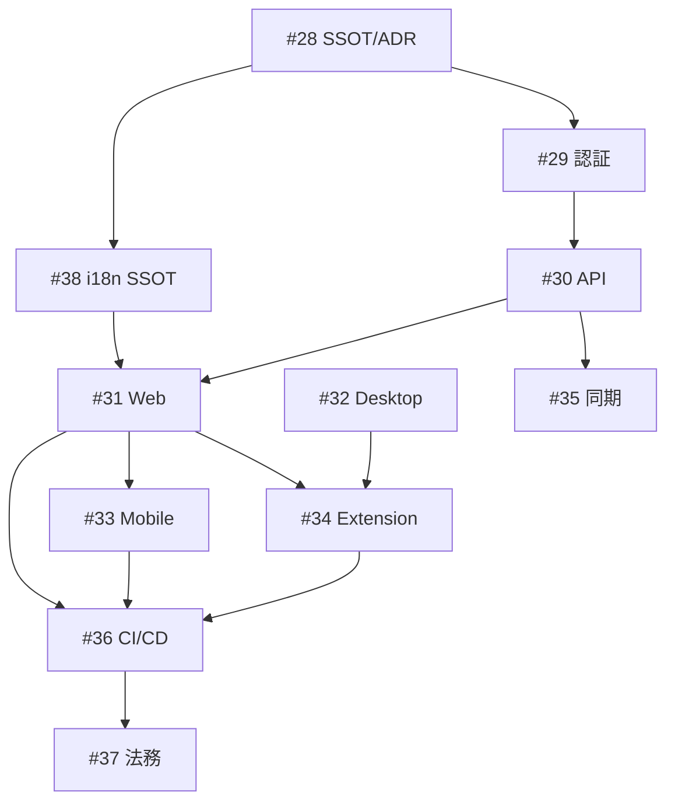

# PassShare v2.0 本番完全版仕様 (SSOT)

> 最終更新: 2026-05-27  
> 関連 Epic: [#28](https://github.com/AutoDevJapan/PassShare/issues/28)  
> 関連 Issue: [#39](https://github.com/AutoDevJapan/PassShare/issues/39)

## 概要

PassShare v2.0 は **本番公開可能な完全版** を定義する。MVP（v0.1）および 1Password Connect 互換（v1 / Epic #9）を土台に、**Web・デスクトップ・モバイル・ブラウザ拡張** の 4 クライアントを揃え、認証・多言語・レスポンシブ・配布・運用まで含む。

| バージョン | 内容 | 状態 |
|-----------|------|------|
| v0.1 | ローカル `.pbox` + Desktop CRUD | ✅ 完了 |
| v1 | Connect API / `op` CLI / SDK / Desktop category UI | ✅ 完了（Epic #9） |
| **v2.0** | **本番完全版（本 SSOT）** | 🚧 進行中 |

## 前提 SSOT

| ドキュメント | 用途 |
|-------------|------|
| [feature-passshare-mvp.md](./feature-passshare-mvp.md) | 用語・暗号・MVP 受入基準 |
| [1password-connect-compatibility.md](./1password-connect-compatibility.md) | Connect API / データモデル |
| [design-system.md](./design-system.md) | デザイントークン・コンポーネント |
| [ui-polish.md](./ui-polish.md) | i18n 骨格・A11y |
| [infrastructure.md](./infrastructure.md) | Vercel / Railway 環境 |
| [ADR 003: マルチクライアント](../adr/003-multi-client-architecture.md) | 4 クライアント・データ経路・拡張接続 |
| [ADR 004: 認証・認可](../adr/004-auth-authorization-model.md) | ユーザー / セッション / Connect トークン |
| [auth-api.md](./auth-api.md) | L1 認証 API（`/api/auth/*`） |
| production-i18n.md | 多言語 SSOT（[#117](https://github.com/AutoDevJapan/PassShare/issues/117) で策定予定） |

## クライアント一覧

| クライアント | パス | 配布 | Epic |
|-------------|------|------|------|
| Web ポータル | `frontend/` | Vercel | [#31](https://github.com/AutoDevJapan/PassShare/issues/31) |
| デスクトップ | `apps/desktop/` | Win / macOS / Linux インストーラー | [#32](https://github.com/AutoDevJapan/PassShare/issues/32) |
| モバイル | `apps/mobile/`（新規） | App Store / Google Play | [#33](https://github.com/AutoDevJapan/PassShare/issues/33) |
| ブラウザ拡張 | `packages/extension/`（新規） | Chrome / Edge / Firefox / Safari | [#34](https://github.com/AutoDevJapan/PassShare/issues/34) |

共有 UI: `shared/ui/`, `shared/i18n/`, `shared/styles/`

---

## 機能マトリクス（Must / Should / Won't）

凡例: **M** = Must（v2.0 リリースブロッカー） / **S** = Should / **—** = v2.0 対象外

### 認証・セキュリティ（Epic [#29](https://github.com/AutoDevJapan/PassShare/issues/29)）

| 機能 | Web | Desktop | Mobile | Extension | Issue |
|------|:---:|:-------:|:------:|:---------:|-------|
| ユーザー登録 / ログイン / ログアウト | M | M | M | M | [#42](https://github.com/AutoDevJapan/PassShare/issues/42)–[#44](https://github.com/AutoDevJapan/PassShare/issues/44) |
| 多ユーザー Connect 認可（共有トークン廃止） | M | M | M | M | [#43](https://github.com/AutoDevJapan/PassShare/issues/43) |
| レート制限・ブルートフォース対策 | M | — | — | — | [#45](https://github.com/AutoDevJapan/PassShare/issues/45) |
| CSP / CORS / セキュリティヘッダー | M | — | — | — | [#46](https://github.com/AutoDevJapan/PassShare/issues/46) |
| クリップボード自動消去 | S | M | M | M | [#48](https://github.com/AutoDevJapan/PassShare/issues/48) |
| 生体認証アンロック | — | S | M | — | [#49](https://github.com/AutoDevJapan/PassShare/issues/49) |

### パスワードボックス操作

| 機能 | Web | Desktop | Mobile | Extension | Issue |
|------|:---:|:-------:|:------:|:---------:|-------|
| パスワードボックス一覧・作成 | M | M* | M | — | [#62](https://github.com/AutoDevJapan/PassShare/issues/62), [#81](https://github.com/AutoDevJapan/PassShare/issues/81) |
| Item CRUD（PASSWORD / SECURE_NOTE） | M | M* | M | S | [#63](https://github.com/AutoDevJapan/PassShare/issues/63), [#81](https://github.com/AutoDevJapan/PassShare/issues/81) |
| 検索 | M | M* | M | M | [#68](https://github.com/AutoDevJapan/PassShare/issues/68) |
| CSV インポート | S | M* | S | — | [#66](https://github.com/AutoDevJapan/PassShare/issues/66) |
| 追加 category（CREDIT_CARD 等） | S | S | S | S | [#53](https://github.com/AutoDevJapan/PassShare/issues/53), [#75](https://github.com/AutoDevJapan/PassShare/issues/75) |

\* Desktop v1 時点でローカル `.pbox` CRUD 済み。v2.0 では Connect API 連携オプション（[#76](https://github.com/AutoDevJapan/PassShare/issues/76)）を Should とする。

### ブラウザ拡張専用

| 機能 | Must | Issue |
|------|:----:|-------|
| ポップアップ UI（ログイン・検索・コピー） | M | [#89](https://github.com/AutoDevJapan/PassShare/issues/89) |
| ログインフォーム検出・オートフィル | M | [#90](https://github.com/AutoDevJapan/PassShare/issues/90) |
| パスワード生成・保存提案 | S | [#91](https://github.com/AutoDevJapan/PassShare/issues/91) |
| Chrome / Edge / Firefox ストア公開 | M | [#92](https://github.com/AutoDevJapan/PassShare/issues/92)–[#94](https://github.com/AutoDevJapan/PassShare/issues/94) |
| Safari Web Extension | S | [#95](https://github.com/AutoDevJapan/PassShare/issues/95) |

### モバイル専用

| 機能 | Must | Issue |
|------|:----:|-------|
| OS オートフィル（Credential Provider / Autofill） | S | [#83](https://github.com/AutoDevJapan/PassShare/issues/83) |
| App Store / Google Play 提出 | M | [#85](https://github.com/AutoDevJapan/PassShare/issues/85) |

### 同期・共有（Epic [#35](https://github.com/AutoDevJapan/PassShare/issues/35)）

| 機能 | v2.0 | Issue |
|------|:----:|-------|
| クラウド同期 MVP（単一ボックス・マルチデバイス） | S | [#99](https://github.com/AutoDevJapan/PassShare/issues/99) |
| PassShare Share（チーム共有） | —（v2.1 候補） | [#100](https://github.com/AutoDevJapan/PassShare/issues/100) |
| 1PUX インポート | S | [#54](https://github.com/AutoDevJapan/PassShare/issues/54), [#101](https://github.com/AutoDevJapan/PassShare/issues/101) |

---

## レスポンシブ（Web Must）

Web ポータルは **320px 以上のすべてのビューポート** で UI が崩れないこと（横スクロールによる意図しないレイアウト破壊なし）。

| ブレークポイント | 幅 | レイアウト | Issue |
|---------------|-----|-----------|-------|
| Mobile | ≤640px | 1 カラム、ボトムナビ、タップ 44px+ | [#64](https://github.com/AutoDevJapan/PassShare/issues/64), [#65](https://github.com/AutoDevJapan/PassShare/issues/65) |
| Tablet | 641–960px | 折りたたみナビ、2 カラム可 | [#64](https://github.com/AutoDevJapan/PassShare/issues/64) |
| Desktop | ≥961px | サイドバー + メイン | [#64](https://github.com/AutoDevJapan/PassShare/issues/64) |

### 受入基準（ATDD）

```gherkin
Given Web アプリを 320px 幅のビューポートで表示した
When  パスワードボックス一覧画面を開く
Then  横スクロールなしで主要操作（作成・検索・開く）が可能

Given Web アプリを 375px 幅（iPhone SE 相当）で表示した
When  Item 作成フォームを開く
Then  すべてのラベルと入力欄が読み取り可能で、ボタンが 44px 以上のタップ領域を持つ
```

拡張機能ポップアップ: 最小幅 **320px** で Must（[#89](https://github.com/AutoDevJapan/PassShare/issues/89)）。

---

## 多言語（i18n / l10n Must）

Epic [#38](https://github.com/AutoDevJapan/PassShare/issues/38) に詳細。v2.0 最低ライン:

| 優先度 | 言語 | ロケール | Issue |
|--------|------|---------|-------|
| Must | 日本語 | `ja` | 既存 |
| Must | 英語 | `en` | 既存 |
| Must | ロシア語 | `ru` | [#118](https://github.com/AutoDevJapan/PassShare/issues/118) |
| Should | 独・仏・西・中・韓・葡 | `de`, `fr`, `es`, `zh-CN`, `zh-TW`, `ko`, `pt-BR` | [#119](https://github.com/AutoDevJapan/PassShare/issues/119) |

表示保全（Must）:

- スクリプト別タイポグラフィ（CJK / Latin / Cyrillic）— [#120](https://github.com/AutoDevJapan/PassShare/issues/120)
- `word-break: break-all` のグローバル適用禁止（jp-ui-contracts）
- 翻訳キー欠落 CI — [#126](https://github.com/AutoDevJapan/PassShare/issues/126)
- locale 別 Visual Regression — [#128](https://github.com/AutoDevJapan/PassShare/issues/128)

---

## 品質ゲート（v2.0 リリース前）

| 項目 | 基準 | Issue |
|------|------|-------|
| Rust 単体テスト | Docker 上で全 pass | [#105](https://github.com/AutoDevJapan/PassShare/issues/105) |
| Backend 統合テスト | npm test 全 pass | [#58](https://github.com/AutoDevJapan/PassShare/issues/58) |
| Web E2E | ログイン → CRUD → ログアウト | [#68](https://github.com/AutoDevJapan/PassShare/issues/68) |
| Lighthouse（Web ランディング + /app） | A11y 90+, Best Practices 90+ | [#69](https://github.com/AutoDevJapan/PassShare/issues/69) |
| Desktop 署名ビルド | Win / macOS / Linux | [#70](https://github.com/AutoDevJapan/PassShare/issues/70)–[#73](https://github.com/AutoDevJapan/PassShare/issues/73) |
| stg 受入 smoke | 全クライアント | [#106](https://github.com/AutoDevJapan/PassShare/issues/106) |
| 利用規約・プライバシー | Web 公開 | [#113](https://github.com/AutoDevJapan/PassShare/issues/113) |

---

## Epic トレーサビリティ

| Epic | # | 子 Issue 範囲 | 完了条件 |
|------|---|--------------|---------|
| v2.0 SSOT / ADR | [#28](https://github.com/AutoDevJapan/PassShare/issues/28) | #39–#41 | 本 SSOT + [ADR 003](../adr/003-multi-client-architecture.md) + [ADR 004](../adr/004-auth-authorization-model.md) Accepted |
| 認証・セキュリティ | [#29](https://github.com/AutoDevJapan/PassShare/issues/29) | #42–#50 | 多ユーザー認可 + セッション |
| Connect API 本番化 | [#30](https://github.com/AutoDevJapan/PassShare/issues/30) | #51–#59 | OpenAPI Must ギャップ 0 |
| Web 完全版 | [#31](https://github.com/AutoDevJapan/PassShare/issues/31) | #60–#69 | 320px レスポンシブ + E2E |
| Desktop 本番化 | [#32](https://github.com/AutoDevJapan/PassShare/issues/32) | #70–#77 | 署名 + 自動更新 |
| スマホアプリ | [#33](https://github.com/AutoDevJapan/PassShare/issues/33) | #78–#86 | ストア提出 |
| ブラウザ拡張 | [#34](https://github.com/AutoDevJapan/PassShare/issues/34) | #87–#97 | 4 ブラウザ + オートフィル |
| 同期・共有 | [#35](https://github.com/AutoDevJapan/PassShare/issues/35) | #98–#103 | 同期 MVP（Should） |
| CI/CD | [#36](https://github.com/AutoDevJapan/PassShare/issues/36) | #104–#110 | main CI green |
| 法務・運用 | [#37](https://github.com/AutoDevJapan/PassShare/issues/37) | #111–#116 | 法務文書公開 |
| i18n / l10n | [#38](https://github.com/AutoDevJapan/PassShare/issues/38) | #117–#131 | ja/en/ru + 表示保全 |

---

## 推奨実装順（依存関係）



1. **#28** → 本 SSOT（#39）、ADR 003/004（#40–#41）
2. **#38** → i18n SSOT + ru + タイポグラフィ（#117–#122）
3. **#29** → 認証基盤（#42–#44）
4. **#30** → API 本番化（#51–#59）
5. **#31** → Web レスポンシブ Must（#64–#65）
6. 並行: **#32** Desktop / **#33** Mobile / **#34** Extension

---

## v2.0 リリース完了条件

- [ ] Epic [#28](https://github.com/AutoDevJapan/PassShare/issues/28)–[#38](https://github.com/AutoDevJapan/PassShare/issues/38) の **Must** 子 Issue がすべて Close
- [ ] 上記機能マトリクスの **M** 列が全クライアントで満たされている
- [ ] Web 320px レスポンシブ受入基準 pass
- [ ] ja / en / ru 切替 + 表示崩れ Visual Regression pass
- [ ] stg 受入 smoke pass（[#106](https://github.com/AutoDevJapan/PassShare/issues/106)）
- [ ] 利用規約・プライバシーポリシー Web 公開（[#113](https://github.com/AutoDevJapan/PassShare/issues/113)）

---

## 関連

- [MVP 機能仕様](./feature-passshare-mvp.md)
- [1Password Connect 互換](./1password-connect-compatibility.md)
- [インフラ](./infrastructure.md)
- [Epic #28 ロードマップコメント](https://github.com/AutoDevJapan/PassShare/issues/28#issuecomment-4554856541)
